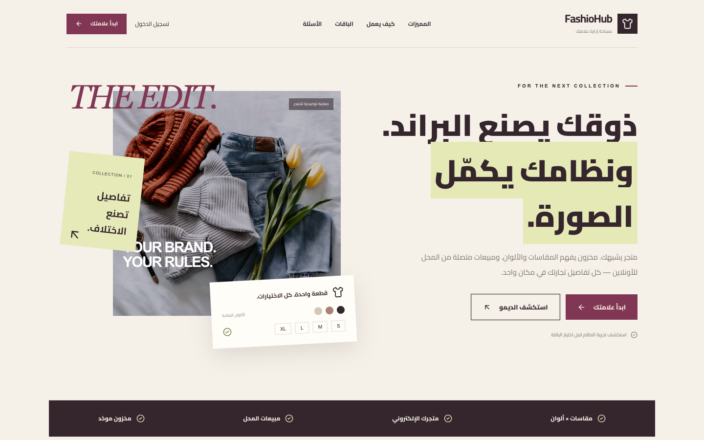
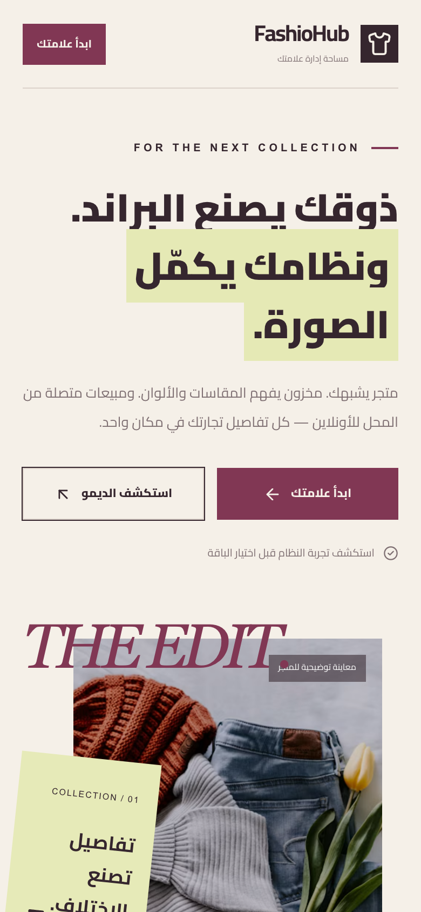
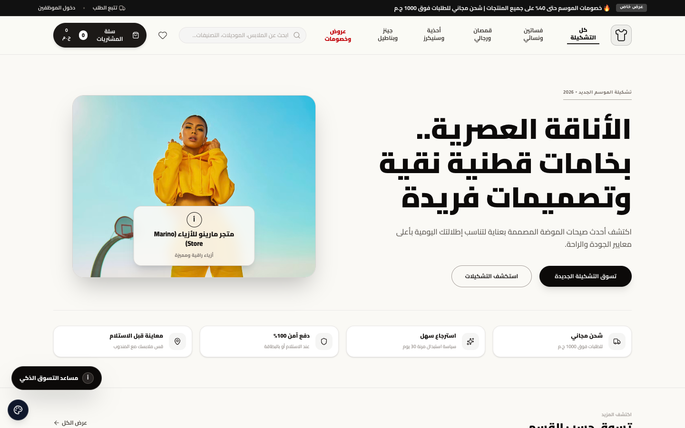
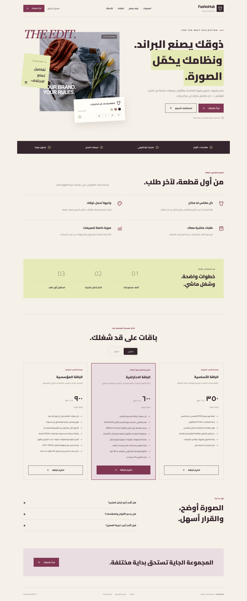

# FashioHub (فاشيو هَب)

> Cloud platform for fashion stores and brands: storefront + POS.

**Live:** [clothes.virvib.com](https://clothes.virvib.com/) · **Role:** Founder & developer · **Period:** 2026 · **For:** Own product

    

## Overview

Fashion retailers run their online store and in-store POS from one system.

## What it does

- Online storefront with product details and size guides
- Visual storefront customizer and themes
- Desktop POS app with offline shift mode
- POS device licensing with activation and remote revocation

## Engineering highlights

- Tauri desktop POS talking to the Laravel API
- Offline fallback for shift operations

## Screenshots (live site)

  
  

Full home page

---

Source code is private (client / commercial project). This repository documents the work only.

Built by **Ahmed Gamal** — Senior Laravel Developer · [LinkedIn](https://www.linkedin.com/in/wzcoder/) · [GitHub](https://github.com/ahmed-gamal-dev)
